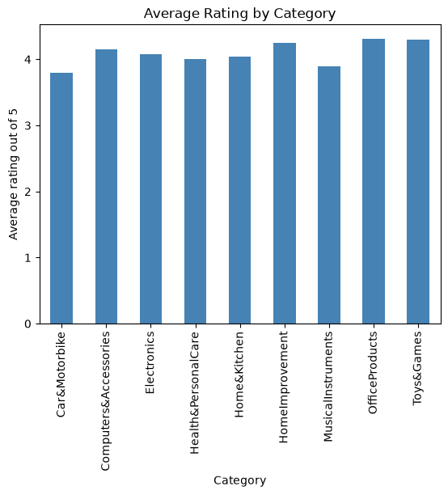
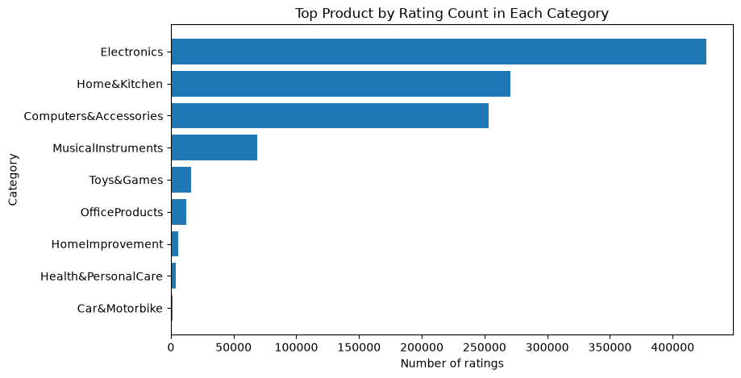
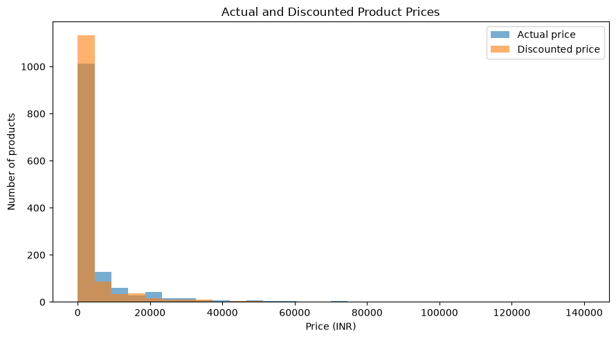
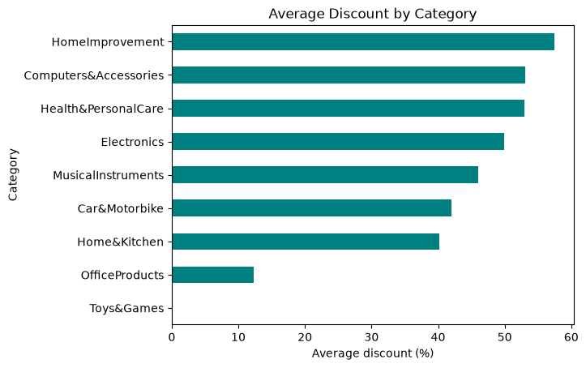
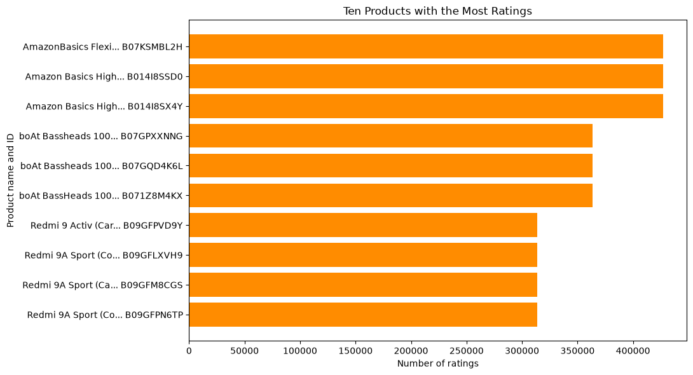

# Week-1-Target-Customer-Sales-Analysis

This project explores an Amazon product dataset with  Python notebooks.

## Project Files

- `Datasets/amazon.csv`: original product and review data.
- `Processed_Datasets/amazon_cleaned.csv`: cleaned product data.
- `Data_processing/clean.ipynb`: data cleaning steps.
- `Data_processing/analysis.ipynb`: analysis tables, charts, and findings.
- `Packages/requirements.txt`: Python packages used in the project.

## Analysis

The analysis notebook answers six questions with five graphs and one table.

### 1. What is the average rating for each category?

OfficeProducts averages 4.31 across 31 listings. Categories with only one or two products should be compared cautiously.

### 2. Which products have the most ratings in each category?

Several Electronics listings have 426,973 ratings each. The notebook also includes a table of the top three products per category.

### 3. How do discounted prices compare with actual prices?

The median actual price is INR 1,795, compared with INR 899 for the median discounted price.

### 4. How does the average discount vary by category?

HomeImprovement averages 57.5%, but has only two listings. Computers & Accessories averages 53.1% across 373 listings.

### 5. Which product names are most popular?

An AmazonBasics HDMI cable leads with 426,973 ratings.

### 6. What do reviews for the most-rated products say?

A table shows sample review titles for the five listings with the most ratings. Examples include phrases such as "good" and "value for money." The source combines several titles in each product row.

Rating counts indicate review activity, not confirmed sales. The dataset does not contain orders or sales dates.

## Run the Notebooks

Install the listed packages, open a notebook in `Data_processing`, and run its cells from top to bottom. The notebooks read the CSV files from the folders in this project.
